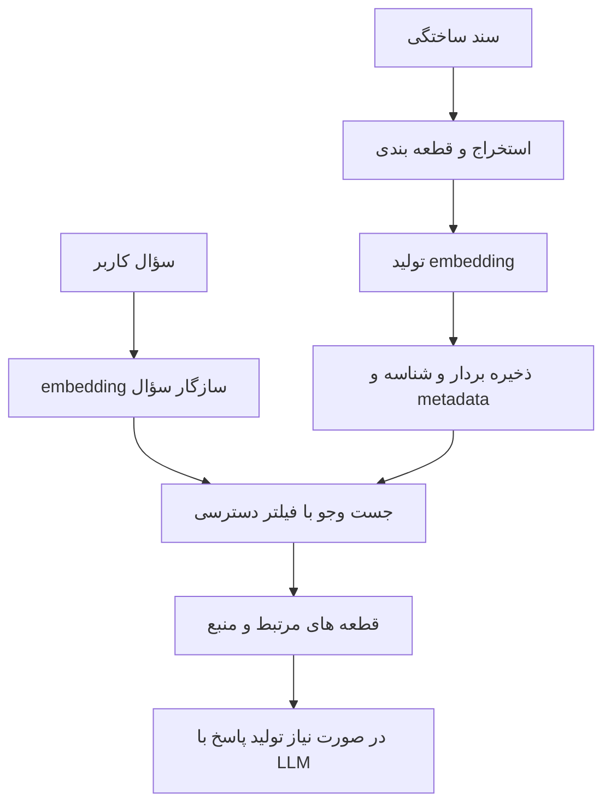

[بازگشت به دفترچه](../../README.md) · [کارگاه مثال‌ها](practice.md)

# پایگاه‌داده‌های برداری از پایه

این جزوه توضیح می‌دهد چرا برای جست‌وجوی معنایی از بردار استفاده می‌کنیم، پایگاه‌دادهٔ برداری چه نقشی دارد، و تفاوت ابزارهایی مثل Qdrant و PostgreSQL همراه pgvector چیست. پس از مطالعه باید بتوانی برای یک مسئلهٔ ساده گزینه‌ها را مقایسه کنی و دلیل انتخابت را توضیح بدهی.

نکتهٔ اصلی: **Embedding را مدل تولید می‌کند، جست‌وجو نزدیک‌ترین نمایش‌های عددی را پیدا می‌کند و برنامه تصمیم می‌گیرد با نتیجه چه کند.** پایگاه‌داده به‌تنهایی پاسخ درست یا یک سامانهٔ RAG کامل نمی‌سازد.

مثال ثابت ما یک کتابخانهٔ فرضی از راهنماهای پشتیبانی است؛ هیچ سند یا دادهٔ محل کار در مثال‌ها استفاده نشده است. این متن یک راهنمای آموزشی است، نه بنچمارک سرعت یا پیشنهاد خرید سرویس. تاریخ بررسی منابع: **۱۰ اکتبر ۲۰۲۶**.

## مسیر مطالعه

- [۱. مسئلهٔ جست‌وجو](#lesson-1)
- [۲. بردار و embedding](#lesson-2)
- [۳. شباهت و فاصله](#lesson-3)
- [۴. مسیر سند تا نتیجه](#lesson-4)
- [۵. ذخیره‌سازی و ایندکس](#lesson-5)
- [۶. جست‌وجوی دقیق و تقریبی](#lesson-6)
- [۷. آشنایی با Qdrant](#lesson-7)
- [۸. PostgreSQL و pgvector](#lesson-8)
- [۹. مقایسهٔ دو انتخاب](#lesson-9)
- [۱۰. گزینه‌های دیگر](#lesson-10)
- [۱۱. جست‌وجوی ترکیبی و بازرتبه‌بندی](#lesson-11)
- [۱۲. فیلتر و مجوز](#lesson-12)
- [۱۳. ارزیابی و عیب‌یابی](#lesson-13)
- [۱۴. نگهداری و تغییر مدل](#lesson-14)
- [۱۵. رابطه با MCP](#lesson-15)
- [سؤال‌ها و پاسخ مرور](#review)
- [واژه‌نامه](#glossary)

<a id="lesson-1"></a>
## ۱ چرا جست‌وجوی واژه‌ای همیشه کافی نیست

فرض کن سندی با عنوان «بازیابی گذرواژه» داریم، اما کاربر می‌پرسد «رمزم را فراموش کردم، چطور وارد شوم؟». عبارت‌های دو طرف یکسان نیستند؛ درحالی‌که مسئله به هم نزدیک است. جست‌وجوی معنایی تلاش می‌کند این نزدیکی را هم لحاظ کند.

از طرف دیگر، برای پیدا کردن کد دقیق `ERR-1042`، شمارهٔ کالا یا نام یک تابع، تطبیق واژه و نشانه‌های دقیق خیلی مهم است. بنابراین معنایی بودن به معنی بهتر بودن در همهٔ پرسش‌ها نیست. در یک مجموعهٔ آموزشی، هر دو نوع سؤال را نگه دار و نتیجه را ببین.

**تمرین ذهنی:** برای سند «روش لغو سفارش» یک سؤال با همان کلمات و یک سؤال با واژه‌های متفاوت بساز. فکر کن در هر کدام جست‌وجو چه نشانه‌ای برای تطبیق دارد.

<a id="lesson-2"></a>
## ۲ بردار چیست و embedding چه می‌کند

بردار در این بحث یک فهرست مرتب از عددهاست؛ مثلاً `[0.8, 0.2, 0.1]`. تعداد عددها را بُعد یا dimension می‌گوییم. این سه عدد **برای آموزش ساخته شده‌اند**؛ در مدل واقعی نمی‌توانیم معمولاً بگوییم عدد اول دقیقاً «موضوع سفارش» و عدد دوم دقیقاً «احساس کاربر» است.

مدل embedding ورودی مثل متن را به یک نمایش عددی تبدیل می‌کند. این نمایش برای یک نوع مقایسه آموزش دیده است. دو جملهٔ مرتبط ممکن است بردارهایی نزدیک داشته باشند، اما این رفتار باید برای زبان و مسئلهٔ خودمان بررسی شود؛ از اسم مدل نمی‌توان کیفیت فارسی را نتیجه گرفت.

سند و سؤال باید با مسیرهای سازگارِ همان مدل یا مدل‌های صریحاً سازگار تبدیل شوند. بعضی مدل‌ها برای query و document پیشوند یا دستور متفاوت دارند. **یکسان بودن تعداد ابعاد به‌تنهایی کافی نیست**؛ دو فضای برداری متفاوت را نباید بدون بررسی در یک جست‌وجو مخلوط کرد.

تولید embedding ممکن است در برنامهٔ خودت، در سرویس مدل، یا از طریق قابلیت یکپارچهٔ محصول انجام شود. محل اجرای آن را در نقشهٔ معماری مشخص کن. متن اصلی، شناسه، نسخهٔ مدل و تنظیمات قطعه‌بندی را هم نگه دار تا بعداً بتوانی نتیجه را بازسازی کنی.

<a id="lesson-3"></a>
## ۳ شباهت با فاصله چه فرقی دارد

برای رتبه‌بندی باید معیاری تعریف کنیم. سه نام رایج:

| معیار | ایدهٔ ساده | جهت بهتر بودن |
| --- | --- | --- |
| Cosine similarity | جهت دو بردار چقدر شبیه است | مقدار بیشتر |
| Cosine distance | در قرارداد رایج برابر `1 - cosine similarity` | مقدار کمتر |
| Euclidean یا L2 distance | فاصلهٔ هندسی دو نقطه | مقدار کمتر |
| Dot product | مجموع حاصل‌ضرب مؤلفه‌های متناظر | به قرارداد مدل و نرمال‌سازی وابسته؛ برای رتبه‌بندی شباهت معمولاً بیشتر |

برای بردارهای غیرصفر، کسینوس از تقسیم ضرب داخلی بر حاصل‌ضرب طول دو بردار به دست می‌آید. بردار صفر جهت ندارد؛ مثال محاسباتی ما آن را رد می‌کند.

اگر یک API عدد `0.82` برگرداند، هنوز نمی‌دانی نتیجه مناسب است. باید بدانی این عدد similarity است یا distance، با چه معیار و مدلی ساخته شده و روی سؤال‌های آزمایشی تو چه معنایی دارد. **امتیاز شباهت احتمال درست‌بودن پاسخ نیست.**

در [تمرین آفلاین](../../examples/vectors/cosine_demo.py)، با سه بردار دستی می‌بینی چرا جهت بردار مهم است. این تمرین دربارهٔ ریاضی مقایسه است و کیفیت هیچ مدل یا دیتابیسی را اندازه نمی‌گیرد.

<a id="lesson-4"></a>
## ۴ مسیر یک سند تا نتیجهٔ جست‌وجو

یک طراحی آموزشی برای دستیار راهنمای پشتیبانی:



به هر قطعه یا chunk یک شناسهٔ پایدار بده. اگر سند ده قطعه دارد، ده بردار خواهی داشت؛ پس تعداد بردارها لزوماً برابر تعداد فایل‌ها نیست. قطعهٔ خیلی بزرگ ممکن است چند موضوع را مخلوط کند و قطعهٔ خیلی کوچک زمینهٔ جمله را از دست بدهد. اندازهٔ مناسب را با نمونه‌های خودت بسنج.

کنار بردار اطلاعاتی مانند `document_id`، شمارهٔ قطعه، زبان، نسخهٔ سند و گروه دسترسی قرار می‌گیرد. این‌ها metadata هستند. برای ارجاع در پاسخ باید بتوانی از نتیجهٔ برداری به متن و منبع واقعی برگردی؛ خود فهرست عددها قابل استناد به کاربر نیست.

بخش تا «قطعه‌های مرتبط» یک سامانهٔ retrieval است. اگر بعداً آن قطعه‌ها را برای تولید پاسخ به مدل بدهیم، وارد معماری RAG شده‌ایم. جست‌وجوی برداری یکی از روش‌های بازیابی است؛ همهٔ RAGها الزاماً پایگاه‌دادهٔ برداری جدا ندارند.

<a id="lesson-5"></a>
## ۵ مدل و ایندکس و دیتابیس را مخلوط نکنیم

| جزء | چه کاری انجام می‌دهد | چه چیزی را به‌تنهایی حل نمی‌کند |
| --- | --- | --- |
| مدل embedding | تبدیل ورودی به بردار | نگهداری اسناد و مجوز کاربران |
| معیار فاصله | مقایسهٔ عددی | فهم اینکه سند برای پاسخ کافی است |
| ایندکس برداری | کمک به پیدا کردن همسایه‌ها | همهٔ نیازهای ذخیره و سرویس‌دهی |
| پایگاه‌داده | ذخیره، بازیابی و امکانات عملیاتی متناسب با محصول | صحت پاسخ نهایی مدل |
| برنامهٔ RAG | اتصال استخراج، جست‌وجو، زمینه و تولید پاسخ | تضمین خودکار حقیقت |

برای مثال **FAISS یک کتابخانهٔ جست‌وجوی شباهت و خوشه‌بندی است**. می‌توان از آن در یک برنامه استفاده کرد، ولی صرف ساختن ایندکس FAISS معادل داشتن سرویس کامل با هویت کاربران، پشتیبان‌گیری و مدیریت دسترسی نیست. [معرفی رسمی FAISS](https://github.com/facebookresearch/faiss)

<a id="lesson-6"></a>
## ۶ جست‌وجوی دقیق و تقریبی

در جست‌وجوی دقیق، نزدیک‌ترین‌ها با توجه به معیار انتخابی و مجموعهٔ واجد شرایط محاسبه می‌شوند. «دقیق» در اینجا دربارهٔ یافتن همسایهٔ برداری است، نه تضمین ارتباط معنایی سند با سؤال.

جست‌وجوی تقریبی یا ANN همهٔ مقایسه‌ها را به همان شکل انجام نمی‌دهد؛ با ساختار ایندکس، بخشی از هزینهٔ جست‌وجو را کاهش می‌دهد و ممکن است بعضی همسایه‌ها را از دست بدهد. این مبادله را با سرعت و recall بسنج، نه فقط با اینکه پاسخ سریع برگشت.

**HNSW** را می‌توان برای شروع مثل نقشه‌ای چندسطحی از اتصال نقاط تصور کرد؛ جست‌وجو با حرکت روی ارتباط‌ها به همسایه‌ها نزدیک می‌شود. تنظیم جست‌وجوی گسترده‌تر می‌تواند کیفیت بازیابی و هزینه را تغییر دهد. حافظهٔ ساختار هم بخشی از هزینه است. **IVFFlat** مسیر دیگری دارد: بردارها به فهرست‌هایی تقسیم می‌شوند و جست‌وجو تعدادی از آن‌ها را بررسی می‌کند. [pgvector](https://github.com/pgvector/pgvector) · [ایندکس‌های Qdrant](https://qdrant.tech/documentation/manage-data/indexing/)

در آزمایش، یک مجموعهٔ کوچک را با روش دقیق مرجع بگیر و نتیجهٔ تقریبی را با همان داده، فیلتر و معیار مقایسه کن. عدد سرعت بدون دانستن افت recall و منابع مصرفی برای انتخاب کافی نیست.

<a id="lesson-7"></a>
## ۷ Qdrant را چگونه تصور کنیم

Qdrant یک موتور جست‌وجوی برداری است. داده‌ها در collection قرار می‌گیرند؛ هر point شناسه، بردار و در صورت نیاز payload دارد. Payload اطلاعات جانبی مثل زبان و شناسهٔ سند است. تنظیم بُعد و معیار فاصله به پیکربندی بردار مربوط است؛ یک collection می‌تواند تنظیمات چند بردار نام‌دار داشته باشد. [Collections](https://qdrant.tech/documentation/manage-data/collections/)

در مثال ما، یک point می‌تواند به قطعهٔ دوم یک راهنما مربوط باشد. برنامه بردار سؤال را می‌فرستد و از Qdrant نتیجه می‌گیرد. برای فیلترهایی مثل `language = fa` از payload استفاده می‌شود؛ ایندکس payload نیز برای الگوهای فیلتر مهم است. [Filtering](https://qdrant.tech/documentation/search/filtering/)

در طراحی‌ای که جست‌وجو خدمت مستقلی است، Qdrant گزینه‌ای قابل بررسی است. در عوض باید اتصال برنامه به سرویس، ذخیره‌سازی پایدار و هماهنگی با منبع اصلی اسناد را طراحی کنی. این انتخاب معماری است؛ ادعای سریع‌تر بودن در همهٔ پروژه‌ها نیست. [راهنمای شروع محلی](https://qdrant.tech/documentation/quickstart/)

<a id="lesson-8"></a>
## ۸ PostgreSQL همراه pgvector

PostgreSQL یک پایگاه‌دادهٔ رابطه‌ای است؛ **pgvector افزونهٔ برداری آن** است. نام درست مقایسه در این جزوه «PostgreSQL + pgvector» است. بردار می‌تواند ستونی کنار متن و شناسهٔ سند باشد و در SQL جست‌وجو شود. pgvector جست‌وجوی دقیق و ایندکس‌های تقریبی HNSW و IVFFlat دارد. [مستند رسمی pgvector](https://github.com/pgvector/pgvector)

مزیت معماری برای برنامه‌ای که از قبل PostgreSQL دارد، امکان نگهداری دادهٔ برنامه و بردار در همان سامانه است. رابطهٔ قطعه با سند و مالک را می‌توان در مدل داده روشن کرد. تراکنش اجازه می‌دهد چند تغییر مرتبط به‌عنوان یک واحد ثبت یا برگشت داده شوند؛ این تضمین دربارهٔ عملیات داخل تراکنش است، نه تولید embedding در یک سرویس بیرونی. [تراکنش‌ها در PostgreSQL](https://www.postgresql.org/docs/current/tutorial-transactions.html)

افزونه باید روی سرور نصب و در دیتابیس فعال باشد؛ صرف نصب یک کتابخانهٔ Python کافی نیست. نمونهٔ SQL را در [کارگاه](practice.md) می‌خوانیم. ظرفیت مناسب را با بار واقعی بسنج؛ تعداد اسناد به‌تنهایی معیار انتخاب نیست.

<a id="lesson-9"></a>
## ۹ مقایسهٔ Qdrant و PostgreSQL با pgvector

این جدول جمع‌بندی آموزشی از ساختار دو ابزار و **استدلال طراحی** است؛ رتبه‌بندی کارایی نیست.

| معیار | Qdrant | PostgreSQL + pgvector |
| --- | --- | --- |
| نقطهٔ شروع ذهنی | خدمت جست‌وجوی برداری | دیتابیس رابطه‌ای با قابلیت برداری |
| شکل داده در مثال | point و payload در collection | سطر، ستون بردار و جدول‌های مرتبط |
| مسیر استفاده | API و client | SQL و driver دیتابیس |
| ارتباط با دادهٔ اصلی | اغلب باید همگام‌سازی با منبع اصلی را طراحی کرد | اگر داده همان‌جاست، رابطه‌ها و تغییرات در همان مدل داده‌اند |
| پرسش انتخاب | آیا خدمت جست‌وجو را مستقل اداره می‌کنیم؟ | آیا استفاده از زیرساخت رابطه‌ای موجود مسئله را ساده می‌کند؟ |
| معیار قضاوت نهایی | آزمایش با داده و فیلتر و بار خودمان | همان آزمایش با شرایط قابل مقایسه |

**سناریوی اول:** اپ از قبل سند، کاربر و مجوز را در PostgreSQL نگه می‌دارد و تیم کوچک است. برای نمونهٔ اولیه، بررسی pgvector می‌تواند تعداد سامانه‌هایی را که باید اداره شوند کاهش دهد.

**سناریوی دوم:** چند برنامه از یک خدمت جست‌وجوی مشترک استفاده می‌کنند و تیم می‌خواهد آن را جدا مدیریت کند. بررسی Qdrant منطقی است؛ قرارداد همگام‌سازی و دسترسی را هم باید طراحی کرد.

این‌ها دو مسیر احتمالی‌اند. جمله‌هایی مثل «تا یک میلیون بردار حتماً این، بعدش حتماً آن» بدون سنجش ابعاد، فیلتر، بار، سخت‌افزار و نیاز تأخیر قابل اتکا نیستند.

<a id="lesson-10"></a>
## ۱۰ گزینه‌های مشهور دیگر

| گزینه | ماهیت و کاربرد قابل بررسی | سؤال قبل از انتخاب |
| --- | --- | --- |
| Chroma | ابزار ذخیره و بازیابی برای کاربردهای AI، با مسیرهای محلی و سرویس‌دهی | برای نمونهٔ سریع شروع می‌کنم یا استقرار چندکاربره؟ |
| Milvus | پایگاه‌دادهٔ برداری با شیوه‌های استقرار مختلف | تیم توان ادارهٔ استقرار انتخابی و اندازه‌گیری بار را دارد؟ |
| Weaviate | دیتابیس با جست‌وجوی برداری و keyword/hybrid و یکپارچه‌سازی مدل‌ها | کدام قابلیت را خود برنامه انجام دهد و کدام را سامانهٔ جست‌وجو؟ |
| Pinecone | سرویس مدیریت‌شدهٔ جست‌وجوی برداری | محل داده، هزینه و محدودیت سرویس برای پروژه مناسب است؟ |
| FAISS | کتابخانهٔ similarity search برای ساخت ایندکس در برنامه | آیا فقط موتور جست‌وجوی درون‌برنامه‌ای می‌خواهم یا سرویس کامل؟ |

منابع مستقیم: [Chroma](https://docs.trychroma.com/docs/overview/introduction)، [Milvus](https://milvus.io/docs/overview.md)، [Weaviate](https://docs.weaviate.io/weaviate)، [Pinecone](https://docs.pinecone.io/guides/get-started/overview)، [FAISS](https://github.com/facebookresearch/faiss).

قابلیت‌های نسخه و نوع استقرار را جدا بخوان. محصولی ممکن است سرویس ابری و اجرای محلی متفاوت داشته باشد. «متن‌باز»، «مدیریت‌شده» و «سریع» سه محور جدا هستند؛ هیچ‌کدام به‌تنهایی پاسخ انتخاب نیستند.

<a id="lesson-11"></a>
## ۱۱ Hybrid search و reranking

فرض کن سؤال هم معنای کلی دارد و هم کد دقیق محصول. می‌توان نتایج جست‌وجوی واژه‌ای و برداری را با یک روش ترکیب رتبه‌ها کنار هم آورد. این ایده را hybrid search می‌نامیم. جمع سادهٔ دو نمره با مقیاس متفاوت همیشه معنای درستی ندارد؛ یکی از روش‌ها RRF است که بر رتبه‌ها تکیه می‌کند. Qdrant برای ترکیب و جست‌وجوی چندمرحله‌ای Query API دارد. [Hybrid queries](https://qdrant.tech/documentation/search/hybrid-queries/)

Reranker روی تعدادی نامزد بازیابی‌شده، ارتباط سؤال و متن را دوباره ارزیابی می‌کند. اگر سند لازم اصلاً وارد فهرست اولیه نشده باشد، صرف بازرتبه‌بندی همان فهرست آن را برنمی‌گرداند. پس انتخاب نامزد و مرتب‌سازی دوباره را جدا آزمایش کن.

PostgreSQL قابلیت full-text search هم دارد؛ آن را با بردار یکی ندان. برای متن فارسی باید پردازش واژه‌ها و پوشش زبان را مستقل بررسی کنی. [مقدمهٔ جست‌وجوی متن PostgreSQL](https://www.postgresql.org/docs/current/textsearch-intro.html)

<a id="lesson-12"></a>
## ۱۲ فیلتر metadata با مجوز دسترسی یکی نیست

در مثال آموزشی می‌گوییم فقط `tenant_id = demo-a` را جست‌وجو کن. این فیلتر به‌تنهایی ورود کاربر یا مالکیت او را ثابت نمی‌کند. مقدار مجاز باید از هویت تأییدشده در بک‌اند بیاید؛ قبول کردن شناسهٔ دلخواه از مرورگر، مرز دسترسی ایجاد نمی‌کند.

در PostgreSQL، سیاست‌های Row-Level Security می‌توانند دسترسی سطری را محدود کنند. باید نقش اجرای query، مالک جدول و نقش‌هایی که سیاست را دور می‌زنند هم بررسی شوند. داشتن یک ستون `tenant_id` معادل فعال بودن RLS نیست. [Row security](https://www.postgresql.org/docs/current/ddl-rowsecurity.html)

کیفیت جست‌وجو نیز با فیلتر عوض می‌شود. در pgvector ممکن است پس از اسکن ANN و اعمال فیلتر، کمتر از تعداد خواسته‌شده نتیجه بماند؛ iterative scan در نسخه‌های پشتیبان می‌تواند جست‌وجو را گسترش دهد. [Filtering و iterative scans](https://github.com/pgvector/pgvector#filtering)

در هر سامانه آزمایشی بپرس: «آیا سند متعلق به کاربر دیگر ممکن است وارد زمینهٔ مدل شود؟» این آزمایش از پرسش «آیا top-k سریع برگشت؟» جداست.

<a id="lesson-13"></a>
## ۱۳ چگونه کیفیت را بسنجیم و خطا را پیدا کنیم

برای یک آزمایش کوچک، ۲۰ سؤال ساختگی و سندهای مربوط به هر سؤال را دستی مشخص کن. چند سؤال هم بنویس که پاسخشان در مجموعه نیست. این مجموعه برای تمرین مناسب است؛ نباید از آن ادعای کیفیت عمومی ساخت.

دو نوع ارزیابی را جدا کن:

- **ANN recall:** نتیجهٔ تقریبی چقدر با همسایه‌های روش دقیق تحت همان معیار و فیلتر مشترک است؟
- **Relevance recall:** چند سندِ واقعاً مرتبط با نیاز کاربر در نتیجه آمده‌اند؟ مرجع اینجا برچسب انسانی است، نه صرف فاصلهٔ برداری.

اگر سند مرتبط پیدا نشد، به‌ترتیب متن استخراج‌شده، قطعه‌بندی، نسخهٔ embedding، بردار سؤال، فیلترها، معیار فاصله و تنظیمات بازیابی را بررسی کن. تعویض فوری دیتابیس ممکن است خطای ورودی را پنهان کند.

برای سنجش هزینه و سرعت، زمان ساخت embedding، زمان query، اندازهٔ داده و RAM را جدا یادداشت کن. میانه و صدک ۹۵ تأخیر روی چند درخواست معنا دارند؛ زمان یک درخواست سرد با یک درخواست گرم قابل مقایسه نیست. سرعت بدون کیفیت و بدون ثبت محیط، گزارش کامل نیست.

برای سؤال بی‌پاسخ، نزدیک‌ترین سند هنوز ممکن است نامربوط باشد. `top_k = 5` درخواست حداکثر پنج همسایه است، نه وعدهٔ پنج شاهد معتبر. سیاست پاسخ ندادن و ارجاع به منبع را در لایهٔ برنامه طراحی کن.

<a id="lesson-14"></a>
## ۱۴ نگهداری داده و تغییر مدل

یک طراحی پیشنهادی برای ثبت قطعه‌ها:

```text
chunk_id, document_id, document_version, chunk_index,
text, language, tenant_id, embedding_model, embedding_version
```

وقتی سند تغییر می‌کند، مشخص کن قطعه‌های قبلی چه می‌شوند. اگر شناسه‌ها با هر بار ورود تصادفی ساخته شوند، ممکن است نسخه‌های تکراری بمانند. اگر حذف فایل فقط از منبع اصلی انجام شود، نسخهٔ قدیمی آن ممکن است هنوز در نتیجهٔ جست‌وجو ظاهر شود.

برای تغییر مدل embedding، ابتدا مجموعهٔ جدا یا ستون/پیکربندی جدا بساز، داده را دوباره تبدیل کن و کیفیت را مقایسه کن. صرفاً چون مدل جدید همان ابعاد را می‌دهد، بردارهای قبلی و جدید را در یک فضای معنایی فرض نکن. این یک الگوی پیشنهادی مهاجرت است؛ جزئیات قطع‌نشدن سرویس به زیرساخت بستگی دارد.

اگر metadata در دو سامانه نگهداری می‌شود، ترتیب به‌روزرسانی، retry و حذف را روی کاغذ بنویس. یک تراکنش دیتابیس اول لزوماً سرویس برداری دوم را هم اتمی به‌روز نمی‌کند. برای مثال آموزشی لازم نیست معماری بزرگی بسازی؛ کافی است این مرز را بشناسی.

<a id="lesson-15"></a>
## ۱۵ رابطهٔ این بحث با جزوهٔ MCP

فرض کن یک MCP server ابزار `search_guides` عرضه می‌کند. ورودی ابزار متن سؤال است. پیاده‌سازی ابزار می‌تواند embedding بسازد، از Qdrant یا PostgreSQL نتیجه بگیرد و متن قطعه همراه منبع را برگرداند.

```text
User → Assistant host → MCP tool → Retrieval application → Vector store
                                      ↓
                              Relevant text + source IDs
```

MCP قرارداد دسترسی به ابزار است؛ دیتابیس برداری محل ذخیره و جست‌وجوی داده است؛ RAG روش استفاده از متن بازیابی‌شده برای تولید پاسخ است. این سه می‌توانند کنار هم باشند، اما جای یکدیگر را نمی‌گیرند. ابزار باید دسترسی کاربر را در مسیر جست‌وجو لحاظ کند، حتی اگر نام ابزار و schema ورودی کاملاً درست باشند. برای مرور نقش‌ها به [جزوهٔ MCP](../mcp/README.md) برگرد.

<a id="review"></a>
## سؤال‌های مرور

۱. چرا برابر بودن ابعاد دو بردار برای مقایسه کافی نیست؟
۲. آیا جست‌وجوی دقیق تضمین می‌کند سند برای سؤال مناسب است؟
۳. تفاوت PostgreSQL و pgvector چیست؟
۴. Payload چه کاربردی دارد؟
۵. چه زمانی بررسی pgvector نقطهٔ شروع مناسبی است؟
۶. چه زمانی Qdrant را در گزینه‌ها می‌گذاریم؟
۷. چرا عدد شباهت `0.9` به معنی احتمال صحت ۹۰ درصد نیست؟
۸. آیا FAISS به‌تنهایی جای تمام اجزای یک دیتابیس را می‌گیرد؟
۹. فرق hybrid search و reranking چیست؟
۱۰. اگر بعد از فیلتر به‌جای پنج نتیجه فقط دو نتیجه آمد، چه بررسی می‌کنی؟
۱۱. اگر کاربر مجاز به دیدن سندی نیست، فیلتر مجوز را از کجا می‌گیری؟
۱۲. آیا برای ساخت ابزار MCP جست‌وجو حتماً باید Qdrant داشته باشیم؟

<details>
<summary>پاسخ‌های پیشنهادی پس از تلاش خودت</summary>

۱. ابعاد فقط شکل داده را مشخص می‌کنند. نسخه و قرارداد مدل نیز باید سازگار باشند تا فاصله در فضای موردنظر معنا داشته باشد.

۲. خیر. دقیق بودن یعنی پیدا کردن همسایه‌های همان معیار؛ کیفیت embedding و مناسب بودن سند مسئلهٔ جداست.

۳. PostgreSQL دیتابیس رابطه‌ای است؛ pgvector افزونه‌ای برای نوع داده و عملیات جست‌وجوی برداری در آن است.

۴. اطلاعات جانبی مثل شناسه، زبان و گروه سند را کنار point نگه می‌دارد و می‌تواند در فیلتر به کار رود.

۵. وقتی دادهٔ اصلی از قبل در PostgreSQL است و کاهش تعداد سرویس‌ها برای تیم ارزش دارد؛ مناسب بودن نهایی را با آزمایش بررسی می‌کنیم.

۶. وقتی یک خدمت جست‌وجوی برداری مستقل می‌خواهیم؛ بار، فیلترها، نگهداری و هزینهٔ هماهنگی داده هم باید بررسی شوند.

۷. نمره از یک تابع مقایسه آمده است؛ احتمال کالیبره‌شدهٔ درست‌بودن پاسخ نیست.

۸. خیر. FAISS کتابخانه است؛ سایر اجزای سرویس مانند هویت، ذخیرهٔ دادهٔ اصلی و دسترسی باید جدا طراحی شوند.

۹. Hybrid چند مسیر بازیابی را ترکیب می‌کند؛ reranking نامزدهای به‌دست‌آمده را دوباره مرتب می‌کند.

۱۰. تعداد رکوردهای واقعاً واجد شرایط، فیلتر، محدودیت جست‌وجوی ANN و تنظیمات ابزار را بررسی می‌کنم؛ ابتدا فرض نمی‌کنم دو سند تنها پاسخ‌های ممکن‌اند.

۱۱. از هویت و سیاست دسترسی تأییدشده در سمت سرور؛ شناسهٔ فرستاده‌شدهٔ دلخواه از مرورگر کافی نیست.

۱۲. خیر. ابزار می‌تواند از هر پیاده‌سازی مناسب بازیابی استفاده کند؛ MCP دربارهٔ قرارداد ابزار است.

</details>

## تمرین ترکیبی

برای ۱۰۰ راهنمای فرضی فارسی، دستیار پرسش‌وپاسخ طراحی کن. مشخص کن متن اصلی کجا می‌ماند، chunk چگونه شناسه می‌گیرد، چه metadataای لازم است و دسترسی کاربر کجا بررسی می‌شود. سپس یک بار طرح را با pgvector و یک بار با Qdrant بکش. به‌جای نوشتن «این سریع‌تر است»، توضیح بده در هر طرح چه چیزهایی باید ذخیره، هماهنگ و اندازه‌گیری شوند.

معیار خودارزیابی: اگر بتوانی مسیر سؤال تا قطعهٔ بازیابی‌شده و بعد پاسخ را توضیح بدهی و هرکدام از «مدل»، «ایندکس»، «دیتابیس» و «مجوز» را در جای خودش قرار بدهی، رابطهٔ اصلی مفاهیم را فهمیده‌ای.

<a id="glossary"></a>
## واژه‌نامهٔ مرور سریع

| اصطلاح | معنی در این جزوه |
| --- | --- |
| Vector | فهرست مرتب عددها |
| Dimension | تعداد مؤلفه‌های بردار |
| Embedding | نمایش عددی ورودی که مدل می‌سازد |
| Chunk | یک قطعه از سند |
| Similarity | معیار شباهت |
| Distance | معیار فاصله |
| Top-k | درخواست نزدیک‌ترین k نتیجه با توجه به قرارداد |
| Metadata / Payload | اطلاعات جانبی رکورد |
| Collection | مجموعهٔ داده در قرارداد محصولی مثل Qdrant |
| Index | ساختار کمکی برای بازیابی |
| ANN | جست‌وجوی تقریبی نزدیک‌ترین همسایه‌ها |
| HNSW | یک خانوادهٔ ایندکس مبتنی بر گراف چندسطحی |
| Recall | میزان بازیابی مرجع موردنظر؛ باید مرجع را تعریف کرد |
| Hybrid search | ترکیب مسیرهای جست‌وجو، مانند واژه‌ای و برداری |
| Reranker | مرحلهٔ بازرتبه‌بندی نامزدها |
| Tenant | یک مشتری یا گروه مستقل در برنامهٔ چندمشتری |
| RAG | بازیابی اطلاعات و استفاده از آن در تولید پاسخ |

## قدم بعدی

[کارگاه کوچک](practice.md) همان سه رکورد را با محاسبهٔ ساده، SQL و درخواست HTTP نشان می‌دهد. ابتدا خروجی مورد انتظار را حدس بزن؛ بعد محاسبهٔ آفلاین را اجرا کن. هدف فهم مسیر است، نه ساختن بنچمارک یا اتصال به دادهٔ واقعی.
